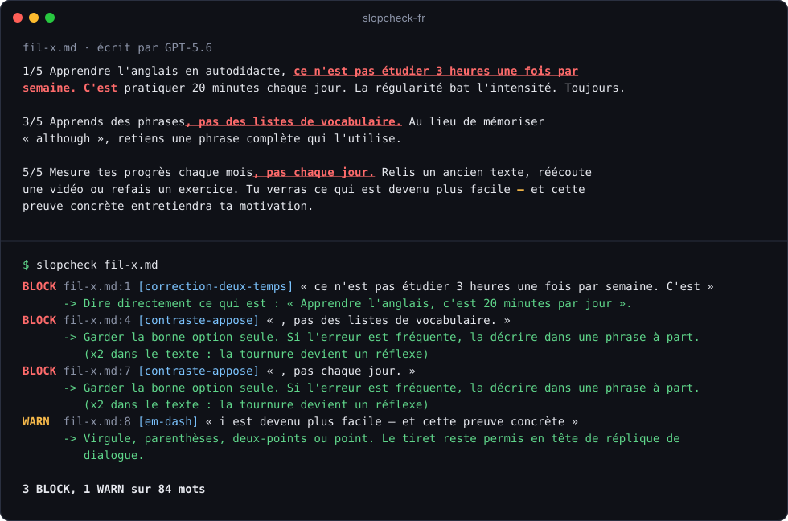

<div align="center">

# slopcheck-fr

**Le correcteur des tics d'écriture IA, pour vos textes en français.**

<!-- slopcheck: off -->
Le « ce n'est pas X, c'est Y », l'émoji en tête de puce, le « niché au cœur de » : vos lecteurs les repèrent tout de suite.<br>
slopcheck les relève dans votre texte et vous dit comment réécrire chaque phrase.
<!-- slopcheck: on -->

[](https://github.com/tns-research/slopcheck-fr/actions/workflows/ci.yml)
[](LICENSE)
[](#essayer-en-30-secondes)

[Essayer](#essayer-en-30-secondes) · [Les 10 tics](#les-10-tics) · [Dans votre agent](#dans-votre-agent-ia) · [Mesures](#mesures) · [Limites](#limites)

<br>

<a href="#dans-votre-agent-ia"></a>
<a href="#dans-votre-agent-ia"></a>
<a href="#dans-votre-agent-ia"></a>
<a href="#dans-votre-agent-ia"></a>
<a href="#dans-votre-agent-ia"></a>
<a href="#dans-votre-agent-ia"></a>
<a href="#dans-votre-agent-ia"></a>
<a href="#dans-votre-agent-ia"></a>

<sub>Un skill pour votre agent de code : il passe slopcheck sur chaque texte qu'il rédige et corrige avant de vous le rendre.</sub>

<br>



</div>

## Essayer en 30 secondes

```bash
pip install git+https://github.com/tns-research/slopcheck-fr
slopcheck mon-post.md
```

Sans rien installer, avec [uv](https://docs.astral.sh/uv/) :

```bash
uvx --from git+https://github.com/tns-research/slopcheck-fr slopcheck mon-post.md
```

Python 3.11 ou plus récent suffit. slopcheck n'a aucune dépendance, ne fait aucun appel réseau, et rend le même verdict à chaque passage, en quelques millisecondes. Votre texte reste sur votre machine.

## Avant / après

GPT-5.6 a écrit le fil X de l'image ci-dessus, sans consigne de style ([texte complet](bench/genere-2026-10/gpt-post-x-v4.md)). Après correction, en suivant les indications de slopcheck :

```
1/5 Apprendre l'anglais seul : 20 minutes par jour, tous les jours. Cette routine
installe l'habitude bien mieux que trois heures le dimanche.

3/5 Apprends des phrases entières. Au lieu de mémoriser « although », retiens une
phrase qui l'utilise.

5/5 Fais le point une fois par mois. Relis un ancien texte, réécoute une vidéo ou refais
un exercice : ce qui te bloquait il y a trente jours te paraît plus simple, et cette
preuve entretient la motivation.
```

```console
$ slopcheck --strict fil-x.md
0 BLOCK, 0 WARN sur 78 mots
```

Même le pack strict, qui applique un standard de prose sèche, n'y trouve plus rien.

## Les 10 tics

Chaque exemple « avant » est tiré d'un texte généré en octobre 2026 par Claude (Haiku, Sonnet, Opus) ou GPT-5.6, sans consigne de style. La dernière colonne compte les textes concernés sur les 224 du corpus (`bench/genere-2026-10/`).

<!-- slopcheck: off -->
| # | Tic | Avant | Après | Textes |
|---|---|---|---|---|
| 1 | **Le faux contraste** | « Ce que j'en retiens, ce n'est pas le chrono, c'est ce que la course m'a appris sur moi. » | « Je retiens surtout ce que la course m'a appris sur moi. » | 21 |
| 2 | **Les puces « Mot : explication » en gras** | « - **Les pothos dorés en suspension** : parfaits pour les salles de bain… » | « - Des pothos dorés en suspension, pour les salles de bain sombres. » | 32 |
| 3 | **L'émoji en tête de ligne** | « 🚀 On recrute à Bordeaux ! » puis « 🔧 Concevoir et faire évoluer nos API » | « On recrute deux développeurs back-end à Bordeaux. » | 27 |
| 4 | **Les rituels de réseau social** | « #Recrutement #Bordeaux #Backend #Développeur #Tech #Hiring », « 🧵👇 » | Supprimés. | 23 |
| 5 | **Le mot gonflé** | « Nichée dans une ruelle paisible […], cette authentique maison de pêcheur » | « Maison de pêcheur en pierre blanche, à 10 minutes à pied du Vieux-Port. » | 41 |
| 6 | **Le tiret cadratin** | « Partager ses expériences — y compris ses échecs — fait progresser tout l'écosystème. » | « Partager ses expériences, échecs compris, aide les autres développeurs. » | 24 |
| 7 | **Le plan scolaire** | Intertitre « ## En résumé », paragraphe qui commence par « En définitive, » | Le texte s'arrête sur sa dernière idée. | 17 |
| 8 | **La règle de trois** | « deux événements conviviaux, utiles et ouverts à tous » | « deux événements ouverts à tous » | 54 (`--strict`) |
| 9 | **La fausse révélation** | « Bonne nouvelle : une sauvegarde sérieuse ne demande ni compétences techniques ni gros budget. » | « Une sauvegarde sérieuse se monte sans compétence technique, avec un disque externe. » | 7 |
| 10 | **La typographie anglaise** | "guillemets droits", Casse De Titre À L'Anglaise | « guillemets français », casse de phrase | 3 |

Le faux contraste est le tic le plus résistant. Un article de blog généré puis publié en contenait encore quatre : « et non pour les grands comptes », « pas par le formulaire public », « et non au nom d'un associé », « pas trois mois avant ». Aucun autre tic de la liste n'y figurait.

La typographie anglaise est devenue rare chez les modèles récents : ils écrivent presque tous en guillemets français.

Au-delà de ces dix familles, le pack par défaut compte 50 règles (formules d'ouverture, artefacts de chatbot, champs « [Votre nom] » oubliés, calques de l'anglais…) et le pack strict en ajoute 37. `slopcheck rules` les liste toutes.
<!-- slopcheck: on -->

## Dans votre agent IA

Le dépôt contient un `SKILL.md` au format [Agent Skills](https://agentskills.io), lu par Claude Code, Codex, Cursor, Gemini CLI, Grok Build, GitHub Copilot, Mistral Vibe, OpenCode, Amp et la plupart des agents de code. Une fois le skill installé, l'agent passe slopcheck sur chaque texte qu'il rédige en français et corrige jusqu'à zéro BLOCK avant de vous le rendre.

Installez d'abord la commande `slopcheck` ([Essayer en 30 secondes](#essayer-en-30-secondes)), puis le skill :

```bash
# Claude Code
git clone https://github.com/tns-research/slopcheck-fr ~/.claude/skills/slopcheck-fr

# Codex, Cursor, Gemini CLI, Grok Build, Copilot, Mistral Vibe, Amp…
git clone https://github.com/tns-research/slopcheck-fr ~/.agents/skills/slopcheck-fr

# ou l'installeur universel, qui choisit le bon dossier pour chaque agent
npx skills add tns-research/slopcheck-fr
```

Grok Build lit aussi les skills de Claude Code : une seule installation suffit pour les deux.

## Utilisation

```bash
slopcheck article.md
slopcheck docs/*.md --summary
cat brouillon.txt | slopcheck -
slopcheck --strict post-linkedin.md
```

- **BLOCK** : tournure presque absente de la prose humaine. Le code de retour vaut 1 s'il en reste une, ce qui permet de bloquer un commit ou une CI.
- **WARN** : à relire. Vous la gardez si la tournure est un choix. Une même tournure répétée plusieurs fois passe en BLOCK.

`--format json` sert aux scripts et aux agents, `--format github` annote une pull request.

## Limites

<!-- slopcheck: off -->
**Il juge des tournures, quel que soit l'auteur.** Un humain pressé écrit aussi « Bonne nouvelle : », et slopcheck le relève de la même façon.
<!-- slopcheck: on -->

**Il ne fait pas passer les détecteurs d'IA.** Nous l'avons mesuré avec un détecteur open source ([oculus-v2.0-multilingual](https://huggingface.co/danibor/oculus-v2.0-multilingual)) sur nos 224 textes : le score IA moyen passe de 0,964 à 0,958 après correction avec slopcheck. Ces détecteurs mesurent une empreinte statistique répartie dans chaque phrase, que des retouches de surface ne déplacent pas. slopcheck vise ce que remarque un lecteur.

**Il ne voit pas un texte plat.** 94 textes du corpus sortent sans aucune alerte : la plupart des lettres de motivation, des avis clients, des emails et des discours. Ils sont corrects, génériques, et n'ont aucun tic de surface. Ce qui leur manque se trouve dans le fond : un chiffre, un nom, une date, un avis tranché. Le skill demande à l'agent de relire ce point après le passage de slopcheck.

## Pourquoi des règles plutôt qu'un modèle

- **Le même texte donne toujours le même résultat**, en quelques millisecondes et sans appel réseau. Votre texte reste sur votre machine.
- **Chaque alerte s'explique** : la règle est lisible dans un fichier TOML, avec des exemples fautifs et corrects.
- **Chaque règle est mesurée** sur 1,2 million de mots d'auteurs humains (Voltaire, Dumas, Flaubert, Hugo, Proust, Zola, Verne, Descartes, vingt articles de Wikipédia) et sur 45 README français écrits avant 2021. Le pack par défaut y lève 0,14 BLOCK pour 1 000 mots, soit un pour 7 000 mots environ.

<!-- slopcheck: off -->
Une bonne partie des listes de « mots IA » qui circulent recopient des tics de 2023 : « dans un monde en constante évolution », « il va sans dire », « je serais ravi de ». Sur nos 224 textes d'octobre 2026, la plupart n'apparaissent plus une seule fois. slopcheck garde ces règles, mais ses dix familles principales viennent de ce que les modèles écrivent aujourd'hui.
<!-- slopcheck: on -->

## Mesures

| Corpus | Textes avec au moins un BLOCK (0.1.0) | (0.2.0) |
|---|---|---|
| 224 textes générés, octobre 2026, hors champs à remplir (`placeholder`) | 31 | 62 |
| Les mêmes, avec au moins une alerte BLOCK ou WARN | 84 | 130 |
| 8 textes générés de contrôle, jamais lus pour écrire une règle | 3 | 6 |
| 45 README humains, avant 2021 | 4 | 4 |

Le détail, la méthode et les commandes pour reproduire sont dans [`docs/CALIBRAGE.md`](docs/CALIBRAGE.md).

## Les trois packs fournis

| Pack | Chargé par défaut | Contenu | BLOCK pour 1 000 mots de prose humaine |
|---|---|---|---|
| `fr-signatures` | oui | 45 règles : tournures rares chez un auteur humain, fréquentes dans un texte généré | 0,14 |
| `typo-fr` | oui | 5 règles de typographie française, toutes en WARN | 0 |
| `fr-strict` | non (`--strict`) | 37 règles en plus : voix passive, « pas X mais Y », intensificateurs, règle de trois, objets qui agissent | 0,87 |

Le pack strict applique un standard de prose sèche et factuelle, utile pour un post, un email ou une page de vente. Il relève aussi des tournures que de bons auteurs emploient. Choisissez-le quand vous voulez ce standard.

`slopcheck rules em-dash` affiche une règle avec ses exemples.

## Configuration

`slopcheck init` crée un `.slopcheck.toml` dans le dossier courant. slopcheck cherche ce fichier dans le dossier et ses parents, puis dans `~/.config/slopcheck/config.toml`.

```toml
packs = ["fr-strict", "typo-fr", "./slopcheck-perso.toml"]
disable = ["voix-passive", "typographie"]

[severity]
em-dash = "warn"

[params_add.objet-agent]
sujets_humains = ["kiné", "pharmacien"]
```

`disable` et `severity` acceptent un nom de règle ou de famille. `params_add` complète les listes de mots d'une règle intégrée sans la recopier.

Pour ignorer une alerte dans un fichier markdown :

```markdown
<!-- slopcheck: ignore em-dash -->
Un paragraphe où le tiret est voulu — et assumé.

<!-- slopcheck: off -->
Une citation à laisser telle quelle.
<!-- slopcheck: on -->
```

## Vos propres règles

Vous repérez une tournure que vous ne supportez plus ? `slopcheck learn` en fait une règle à partir d'une phrase, et mesure ses faux positifs sur le corpus humain avant de l'enregistrer :

```bash
slopcheck corpus fetch          # une fois : 1,2 million de mots humains
slopcheck learn "Au final, c'est le client qui décide" --save slopcheck-perso.toml
```

La commande génère le motif, affiche les occurrences trouvées dans la prose humaine et conseille une sévérité : BLOCK sous 0,05 occurrence pour 1 000 mots, WARN sous 0,3, refus au-delà. Une règle s'écrit aussi à la main :

```toml
[[rule]]
id = "au-final"
severity = "warn"
pattern = '''\bau final\b'''
message = "« Au final » : calque familier de « in the end »."
fix = "Finalement, en fin de compte, ou rien."
bad = ["Au final, le client a signé."]
good = ["La version finale part lundi."]
```

`slopcheck test` vérifie que chaque exemple `bad` déclenche sa règle et qu'aucun exemple `good` ne la déclenche.

## Intégrations

Hook [pre-commit](https://pre-commit.com) :

```yaml
repos:
  - repo: https://github.com/tns-research/slopcheck-fr
    rev: v0.2.0
    hooks:
      - id: slopcheck
```

GitHub Actions, avec annotations sur la pull request :

```yaml
- run: pip install git+https://github.com/tns-research/slopcheck-fr
- run: slopcheck --format github $(git ls-files '*.md')
```

## Contribuer

Une nouvelle règle pour le pack commun demande trois choses : le motif, des exemples `bad` et `good`, et le taux mesuré par `slopcheck bench` avant et après. Le détail est dans [`CONTRIBUTING.md`](CONTRIBUTING.md). Les tics relevés dans vos propres textes générés sont les contributions les plus utiles : ouvrez une issue avec l'extrait et le modèle qui l'a écrit.

## Licence

MIT. Les premières règles viennent du guide de rédaction de [swanbase](https://swanbase.co), accélérateur growth pour startups early-stage, et des relectures de son blog en 2026.

Les logos des agents viennent de [Lobe Icons](https://github.com/lobehub/lobe-icons) (MIT) et restent la propriété de leurs éditeurs.
